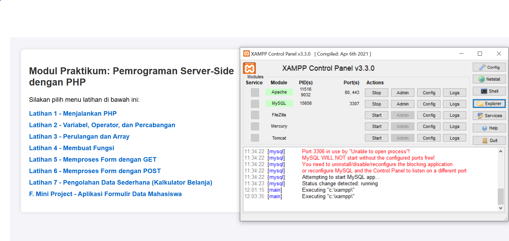
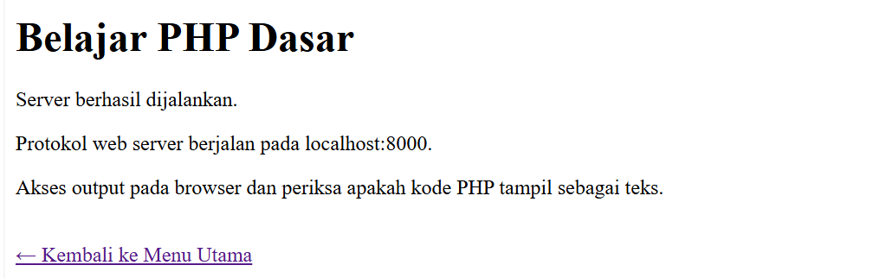
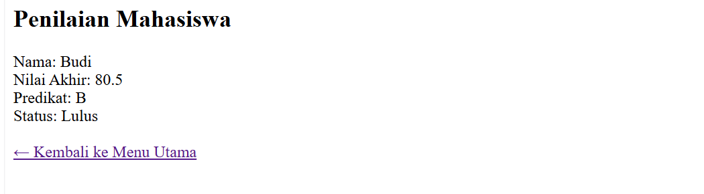
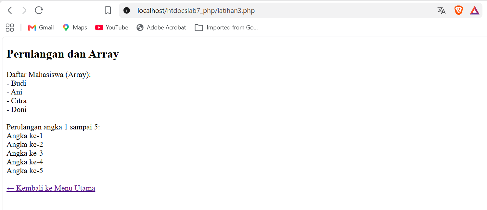
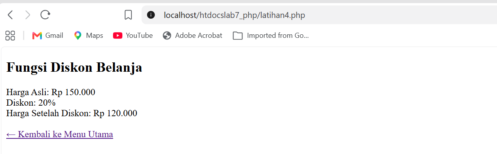
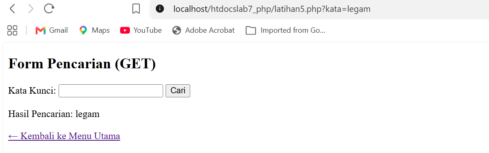
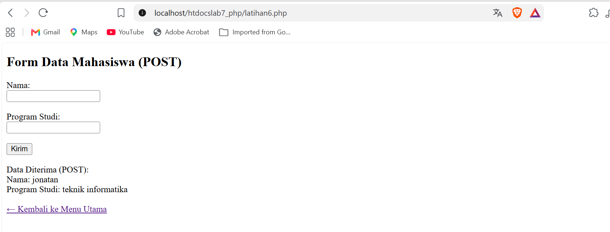
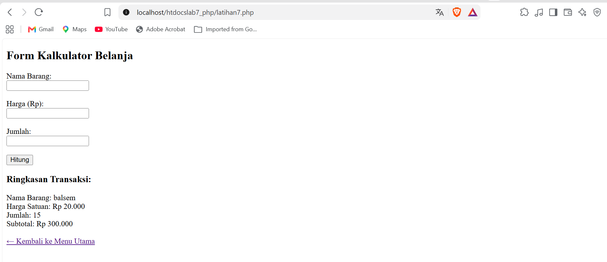
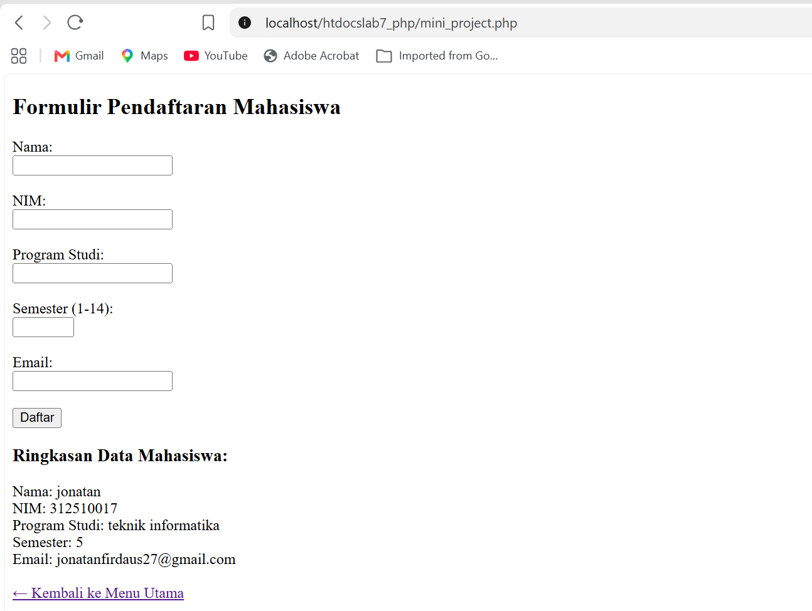

# Laporan Praktikum Pemrograman Web - Modul 7
## Pemrograman Server-Side dengan PHP

---

## 1. Tujuan Praktikum
* Memahami konsep dasar pemrosesan *server-side* menggunakan bahasa pemrograman PHP.
* Mampu mendeklarasikan variabel, menggunakan operator, serta menerapkan struktur kontrol percabangan dan perulangan.
* Mampu mengimplementasikan array dan fungsi modular dalam PHP.
* Memahami pemrosesan data form menggunakan metode HTTP `GET` dan `POST`.
* Membuat aplikasi web sederhana (Mini Project) berupa formulir validasi data mahasiswa.

---

## 2. Perangkat yang Digunakan
* **Web Server & Interpreter PHP:** XAMPP (Apache & PHP v8.x)
* **Code Editor:** Visual Studio Code
* **Web Browser:** Google Chrome / Microsoft Edge
* **Sistem Operasi:** Windows

---

## 3. Cara Menjalankan Server Lokal
1. Pastikan aplikasi **XAMPP Control Panel** sudah terpasang di komputer Anda.
2. Buka XAMPP Control Panel, lalu klik tombol **Start** pada modul **Apache** hingga statusnya berubah menjadi hijau (*Running*).
3. Simpan folder proyek Anda (misalnya `htdocslab7_php`) ke direktori penyimpanan web server XAMPP, yaitu di:
   ```text
   C:\xampp\htdocs\htdocslab7_php\
   ```
4. Buka web browser (Chrome/Edge), lalu ketikkan alamat lokal berikut pada *address bar* dan tekan **Enter**:
   ```text
   http://localhost/htdocslab7_php/
   ```
5. Navigasikan menu melalui antarmuka aplikasi web yang telah disediakan.

---

## 4. Struktur File Proyek
```text
htdocslab7_php/
├── index.php         # File utama (menggabungkan seluruh latihan & mini project via sistem navigasi)
└── README.md         # Dokumentasi laporan praktikum
```

---

## 5. Tempat Penarikan Screenshot Hasil Praktikum
* **halaman awal - Menjalankan PHP:**
 
* **Latihan 1 - Menjalankan PHP:**
 
* **Latihan 2 - Variabel, Operator, dan Percabangan:**

* **Latihan 3 - Perulangan dan Array:**

* **Latihan 4 - Membuat Fungsi:**

* **Latihan 5 - Memproses Form dengan GET:**

* **Latihan 6 - Memproses Form dengan POST:**

* **Latihan 7 - Kalkulator Belanja (Pengolahan Data Sederhana):**

* **Mini Project - Formulir Data Mahasiswa:**


